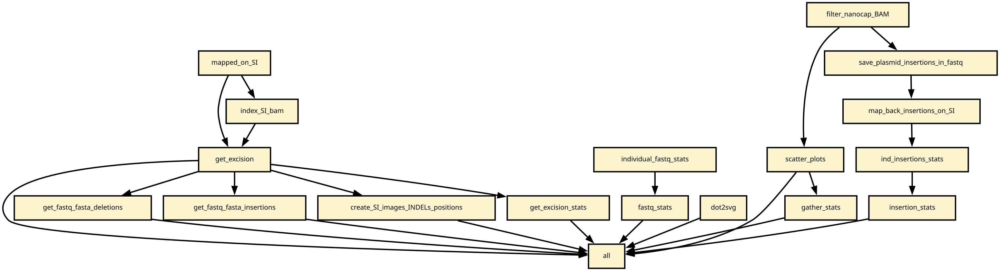

.. image:: https://badge.fury.io/py/sequana-superin.svg
     :target: https://pypi.python.org/pypi/sequana_superin

.. image:: https://github.com/sequana/superin/actions/workflows/main.yml/badge.svg
   :target: https://github.com/sequana/superin/actions/workflows

.. image:: http://joss.theoj.org/papers/10.21105/joss.00352/status.svg
   :target: http://joss.theoj.org/papers/10.21105/joss.00352
   :alt: JOSS (journal of open source software) DOI

.. image:: https://img.shields.io/badge/python-3.9%20%7C%203.10%20%7C%203.11-blue.svg
    :target: https://pypi.python.org/pypi/sequana_superin
    :alt: Python 3.9 | 3.10 | 3.11

This is the **superin** pipeline from the `Sequana <https://sequana.readthedocs.org>`_ project

:Overview: Study the insertions and deletions (INDELs) of super integrons (SI) in Nanopore reads
:Input: Nanopore FASTQ files, BAM files (e.g. from `sequana_nanocap <https://github.com/sequana/nanocap>`_), a samplesheet, the SI reference and the plasmid references (FASTA)
:Output: INDEL tables (CSV), plots (PNG), reads with INDELs (FASTQ/FASTA), BAM files, and an HTML report
:Status: beta
:Citation: Cokelaer et al, (2017), 'Sequana': a Set of Snakemake NGS pipelines, Journal of Open Source Software, 2(16), 352, JOSS DOI doi:10.21105/joss.00352

Principle
~~~~~~~~~

Excisions of cassettes from a super integron (SI) can be seen from two sides:

- **Deletions** are found directly in the reads mapped onto the SI (reads of type SI1-D-SI2).
- **Insertions** are found in the reads mapped onto the plasmid that received the excised
  sequence (reads of type P1-I-P2). The inserted sequences are then extracted and mapped
  back onto the SI to find where they come from.

Only large INDELs are kept (see ``INDELs_filter`` below). Low-complexity INDELs (e.g.
GTGTGT...), most probably Nanopore errors, are discarded using the Shannon entropy of
their sequence.

Installation
~~~~~~~~~~~~

**sequana_superin** is based on Python3. Install the package as follows::

    pip install sequana_superin --upgrade

or from the sources::

    poetry install

Third-party software (minimap2, samtools, graphviz) can be installed with conda
(see ``environment.yml``) or used through Apptainer images (see below).

Usage
~~~~~

Three inputs are required in addition to the reads:

``--samplesheet``
    a CSV file with 3 columns: ``sample``, ``plasmid``, ``reference``. ``sample`` must match
    the FASTQ file names (``SAMPLE.fastq.gz``) and the BAM file names (``SAMPLE.sorted.bam``).
    ``plasmid`` is the name of the plasmid sequence in the reference and ``reference`` is the
    FASTA file (without directory) containing that plasmid. If no plasmid was used, leave the
    ``plasmid`` column empty: only the analysis on the SI is performed.

``--SI-reference-file``
    the FASTA file of the super integron.

``--plasmids-directory``
    the directory where the plasmid references listed in the samplesheet are found.

Example of samplesheet::

    sample,plasmid,reference
    Y305,pV827,pV827.fa
    Y308,pV830,pV830.fa
    Y306,pV827,pV827.fa

Initialise the pipeline::

    sequana_superin --input-directory data/fastq --input-bam-pattern data/bam \
        --samplesheet samplesheet.csv --SI-reference-file SI.fa \
        --plasmids-directory references/

``--input-directory`` is the directory with the FASTQ files and ``--input-bam-pattern`` the
directory with the BAM files. Use ``--help`` to see all the options (e.g. SLURM options).

This creates a directory (called ``superin`` by default) with the pipeline and its configuration
file. The references and the samplesheet are copied in this directory for book keeping. You then
need to execute the pipeline::

    cd superin
    bash superin.sh  # for a local run

This launches a snakemake pipeline. If you are familiar with snakemake, you can
retrieve the pipeline itself and its configuration files and then execute the pipeline
yourself with specific parameters::

    snakemake -s superin.rules -c config.yaml --cores 4 --stats stats.txt

Or use `sequanix <https://sequana.readthedocs.io/en/main/sequanix.html>`_ interface.

Usage with apptainer
~~~~~~~~~~~~~~~~~~~~

With Apptainer, initiate the working directory as follows::

    sequana_superin --apptainer-prefix ~/.sequana/apptainers [other options]

Images are downloaded once in the directory given by ``--apptainer-prefix``. Then::

    cd superin
    bash superin.sh

If you decide to use snakemake manually, do not forget to add the apptainer options::

    snakemake -s superin.rules -c config.yaml --cores 4 --stats stats.txt --use-apptainer --apptainer-prefix ~/.sequana/apptainers --apptainer-args "-B /home:/home"

By default, the home is already set for you. Additional binding paths can be set using
environment variables e.g.::

    export APPTAINER_BINDPATH=" -B /pasteur"

Requirements
~~~~~~~~~~~~

This pipeline requires the following executables:

- minimap2
- samtools
- graphviz

and the Python packages sequana, sequana_pipetools, pysam, pandas, matplotlib and plotly.

Details
~~~~~~~

The pipeline runs the following steps for each sample of the samplesheet:

1. **Map onto the SI**: the reads are mapped onto the SI reference with minimap2
   (``SI/SAMPLE.sorted.bam``).
2. **Deletions and insertions on the SI**: INDELs are extracted from the BAM file and filtered
   (length, entropy, position). Reads with INDELs are saved as FASTQ and FASTA files
   in ``SI/fastq`` and ``SI/fasta``.
3. **Plasmid analysis** (only if plasmids are given in the samplesheet): the BAM files are
   filtered to keep the reads mapped on the plasmid (``filtered_BAM_files``). Insertions and
   deletions are extracted and shown as scatter plots (position on the plasmid versus length)
   in ``plasmids/``. The sequences of the insertions are mapped back onto the SI
   (``mapped_insertions_on_SI``).
4. **Summary tables** (CSV) and an **HTML report** (``summary.html``) combining the tables
   and figures, including the localisation of the INDELs along the SI.

Main outputs:

=================================================== ===========================================
File or directory                                   Description
=================================================== ===========================================
summary.html                                        final report
SI/distribution_entropy_of_deletions_insertions_on_SI.csv  INDEL counts on the SI per sample
SI/position_deletions.png, position_insertions.png  INDEL positions on the SI
SI/fastq, SI/fasta                                  reads with deletions/insertions on the SI
plasmids/deletions_insertions_stats.csv             INDEL counts on the plasmids per sample
plasmids/SAMPLE_*_distribution.{png,csv}            INDELs on the plasmids
mapped_insertions_on_SI/insertions_summary.csv      plasmid insertions mapped back onto the SI
nanocap_filtered_fastqs/stats.csv                   statistics on the input FASTQ files
=================================================== ===========================================

Rules and configuration details
~~~~~~~~~~~~~~~~~~~~~~~~~~~~~~~

Here is the `latest documented configuration file <https://raw.githubusercontent.com/sequana/superin/main/sequana_pipelines/superin/config.yaml>`_
to be used with the pipeline. Each rule used in the pipeline may have a section in the configuration file.

The main parameters are:

- ``minimap2``: ``threads`` and ``options`` (default ``-x map-ont``) used to map onto the SI.
- ``INDELs_filter``:

  - ``minimal_indel_length`` (default 100): INDELs shorter than this (bp) are ignored.
  - ``entropy_above`` (default 1.2): INDELs with a lower sequence entropy are ignored
    (natural logarithm; maximum is ln(4)=1.39).
  - ``SI_start_position`` (default 10500): INDELs located before this position on the SI are ignored.

Changelog
~~~~~~~~~

========= ====================================================================
Version   Description
========= ====================================================================
0.1.1     Fix deleted sequences taken from the first contig of the reference
          instead of the contig the read is mapped on.
0.1.0     **First release.**
========= ====================================================================

Contribute & Code of Conduct
~~~~~~~~~~~~~~~~~~~~~~~~~~~~

To contribute to this project, please take a look at the
`Contributing Guidelines <https://github.com/sequana/sequana/blob/main/CONTRIBUTING.rst>`_ first. Please note that this project is released with a
`Code of Conduct <https://github.com/sequana/sequana/blob/main/CONDUCT.md>`_. By contributing to this project, you agree to abide by its terms.
